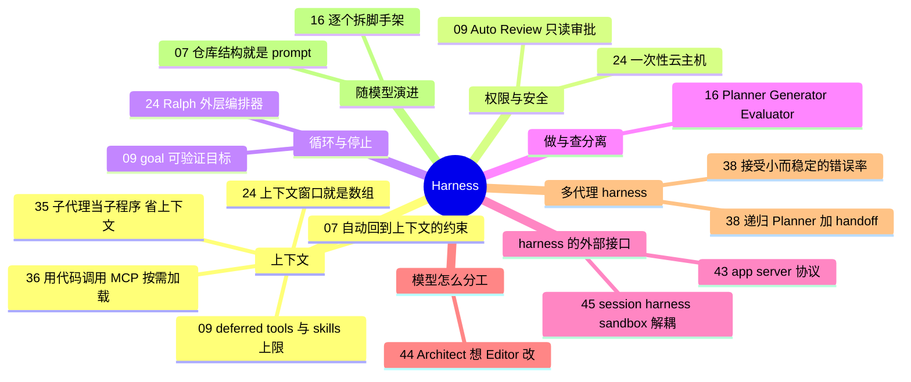

# 看原理 · Harness 与内部机制

**这个阶段回答**：前面五个阶段用到的做法，背后的机制是什么？模型外面那层“驾驭工具”（harness）怎么设计，上下文、权限、循环、验证分别交给谁？收录 9 份资料：[[09]]、[[24]]、[[16]]、[[35]]、[[36]]、[[38]]、[[43]]、[[44]]、[[45]]。

::: tip 怎么用这页
每个问题下面列出“哪份资料的哪一节回答了它”。指南只做串联和对照，原话和细节请点进原文。
:::

## 1. Harness 到底包括什么？

- **一份产品级 harness 的全貌**：Codex 团队拆解了协议、上下文构建、动作（子代理 / 后台终端 / 浏览器）、自动审批、速度、`/goal`、压缩（[[09§3.1]] 到 [[09§3.7]]）。
- **团队级 harness**（属于 [打地基](/guide/foundation)）：OpenAI Frontier 团队把非功能性需求写成 CI 审查代理、仓库专属 lint、结构测试，让约束“自动回到上下文里”（[[07§3.2]]）；仓库结构本身也是 prompt（[[07§3.5]]）。
- **代理就是“模型 + 工具 + 循环”**：Amp 的 Beyang Liu 认为构建者能调的只有三根杠杆：选哪个模型、工具怎么描述、模型和工具怎么迭代（[[35§3.1]]）。
- **harness 也是可替换的部件**：Anthropic 把代理拆成 session（只追加日志）、harness（循环）、sandbox（执行环境）三个接口，每个都能单独失败和替换（[[45§2]]、[[45§3.2]]）。
- **“双手”也可以交给客户**：Cursor Self-Hosted Machines 把执行环境放进客户网络、循环留在 Cursor 云端，是同一种拆分的产品化（[[51§3.1]]）。
- **在现成 harness 上构建**：Codex 的 app server 是包住 harness 的 JSON-RPC 协议，Codex 应用和第三方客户端都用它；建议自己打包 harness、工具标成 deferred、用 developer instructions 追加而不是重写系统提示词（[[43§3.1]]、[[43§3.6]]）。
- **个人级 harness**：Mitchell 的定义很朴素：每犯一个错，就改一次环境，让它不再犯（[[27§3.5]]）。

## 2. 上下文怎么分配？

- **心智模型：上下文窗口就是一个数组**。服务端没有记忆，数组就是记忆；模型需要“滑动”的范围越小越好。因此每轮开头固定放入规格索引（有意分配），一轮只做一件事（[[24§3.2]]、[[24§3.3]]）。
- **控制体积**：Codex 把部分工具延后到搜索时再加载，skills 列表上限设为上下文窗口的 2%（[[09§3.2]]）。
- **工具也吃上下文**：工具定义和工具调用结果都占上下文。Amp 选择少接 MCP、精心打磨自己的工具，避免“上下文混乱”（[[35§3.2]]）；Anthropic 则把 MCP 服务器包装成文件系统里的代码 API，代理按需读取工具文件，大数据在执行环境里过滤（[[36§3.3]]、[[36§3.4]]）。
- **读太多和读太少都会失败**：读太多会耗尽上下文，读太少会陷入“死循环”（doom loop）；Amp 把子代理当作“子程序”，把搜索等子任务的上下文隔离出去（[[35§3.3]]），并按专长分工（[[35§3.4]]）。这和 [[04§3.3]] 的观点一致。
- **完整历史和上下文分开**：Managed Agents 把可恢复的事件存储放在 session，把怎么挑选、变换上下文交给 harness，避免压缩这类不可逆决定（[[45§3.4]]）。
- **推理和输出格式分开**：Aider 让 Architect 模型只想方案、Editor 模型只写格式正确的编辑，多数组合比单独使用分数更高（[[44§3.2]]、[[44§4]]）。
- **Just-in-time 约束**：先让代理自由探索，到 lint / test 阶段再施加约束（[[07§3.3]]）。

## 3. 权限怎么放？

- **放开权限前先隔离**：Ralph 要无人值守地跑，必须放在隔离环境里；Dex 用没有公网 IP 的专用虚拟机，机器上只放模型 API key 和 deploy key（[[24§3.1]]）。
- **用一个只读子代理替你审批**：Codex Auto Review 分别判断“用户是否授权”和“影响多大”（[[09§3.4]]）。凭据最好结构性地放在沙箱之外：Managed Agents 用 git remote 和 MCP 代理服务让 token 根本碰不到生成的代码（[[45§3.3]]）。Cursor 的 Auto-review 用小模型分类器，跑在主代理同一个 RPC 流里以免多一次往返，拦截时把理由还给主代理（[[39§3.2]]、[[39§3.3]]）。

## 4. 代理什么时候停？

- **可验证目标**：`/goal` 下，模型调用 `update_goal` 才结束循环，所以目标要写成可检查的条件（[[09§3.6]]）。
- **外层循环**：Ralph 的本质是外层编排器，不在会话内部循环；commit、push、是否回滚这类确定性步骤交给外层脚本（[[24§3.5]]）。官方插件则用 Stop hook 在同一会话里续跑（[[24§3.4]]）。
- **单独的评估者**：Anthropic 的长任务 harness 由 Evaluator 用 Playwright 实际操作应用来判定 sprint 是否完成（[[16§3.2]]、[[16§3.3]]）。

## 5. 多代理 harness 怎么一步步改出来？

- **先做可观测性**：所有代理消息和命令输出带时间戳记录，再让代理分析日志找模式（[[38§3.1]]）。
- **一个代理别扛太多角色**：去掉 Planner 的“持续执行者”同时规划、派活、审代码、合并、判断结束，结果出现随机睡眠、过早宣布完成等病态行为（[[38§3.3]]）。最终版是根 Planner + 递归子 Planner + 只管自己任务的 Worker + 交接报告（[[38§3.4]]）。
- **为吞吐设计**：要求每次提交 100% 正确会让系统串行化；接受小而稳定的错误率，最后留一轮修复（[[38§3.5]]）。
- **开发体验决定吞吐**：几百个代理同时编译，磁盘成了瓶颈；拆成独立 crate 后吞吐提高数倍（[[38§3.6]]）。

## 6. Harness 要随模型变化而调整

- **逐个拆脚手架**：每个 harness 组件都编码了一条“模型自己做不到”的假设；模型升级后要一次删一个组件，看结果变化（[[16§3.5]]）。
- **同样的思路**：Claude Code 团队删掉 80% 的系统提示词（[[06§3.2]]）；模型变强后删掉为旧模型打的补丁（[[02§3.2]]），并让 harness 更精简（[[01§3.7]]）。Cursor 云端代理把多仓库、CI 日志这类硬编码逻辑换成代理能控制的工具（[[40§3.4]]）。

## 7. 来源之间的分歧

| 议题 | 观点 A | 观点 B | 怎么理解 |
|---|---|---|---|
| 长会话：压缩还是重开 | Anthropic：Opus 4.5 起去掉 context reset，用 SDK 自动压缩跑连续会话（[[16§3.5]]）；Codex 服务端自动压缩（[[09§3.7]]） | Huntley：压缩有损，每轮全新上下文（[[24§3.4]]） | 和模型能力相关：Anthropic 的变化正是模型升级带来的。全新上下文的代价是每轮要重新读规格，好处是可预测。详见[长时自主任务专题](/guide/long-running)。 |
| 工具多了怎么办 | Amp：核心工具自己打磨，不一股脑接 MCP；工具越多代理越容易困惑（[[35§3.2]]） | Anthropic：工具可以很多，但不要一次全部加载，用文件树和搜索按需读取（[[36§3.3]]、[[36§3.4]]） | 都承认“工具定义占上下文、会干扰选择”。Amp 从**减少**工具入手，Anthropic 从**延迟加载**入手；Codex 的 deferred tools（[[09§3.2]]）是第二种思路的产品实现。 |
| 推理模型怎么用 | Amp：做成子代理（`Oracle`），主代理需要时才调用，不提供模型选择器（[[35§3.4]]、[[35§3.5]]） | 多数代理：让用户在界面里选模型（Amp 的描述） | Amp 的理由是只针对少数模型深度优化；但 Amp 后来也承认，模型变强后 harness 的影响在减小（[[35§4]]）。 |
| 要不要每步都对 | Carlini：验证器要近乎完美，否则代理会去解决错误的问题（[[17§3.3]]） | Cursor：每次提交都要求 100% 正确会让系统停摆，接受小而稳定的错误率（[[38§3.5]]） | 说的是不同层次：最终验收的标准要高；中间提交可以放宽，但需要一个最终的整合修复环节。 |
| 推理模型怎么接进来 | Amp：推理模型做成子代理，主代理需要时调用（[[35§3.4]]） | Aider：推理模型当 Architect 写方案，另一个模型当 Editor 落编辑（[[44§3.2]]） | 都是按角色分模型：Amp 按“难题”分，Aider 按“推理 vs 输出格式”分。Aider 的数据来自 2024 年的模型，今天推理模型输出格式的能力已强很多。 |
| 循环放在哪 | Ralph：外层 bash，会话外（[[24§3.5]]） | `/goal`、官方 Ralph 插件：harness 内部（[[09§3.6]]、[[24§3.4]]） | 外层更可控、可插入确定性步骤；内部更省事。 |

## 8. 推荐阅读顺序

1. [[24]]：先建立“上下文是数组”的心智模型。
2. [[09]]：看一份产品级 harness 的完整拆解。
3. [[16]]：做与查分离，以及随模型升级拆脚手架。
4. [[35]]：子代理和工具集的设计取舍。
5. [[36]]：工具很多时，怎么用代码调用省上下文。
6. [[38]]：多代理 harness 每一版为什么失败、最后怎么定型（先读 [[18]]）。
7. [[45]]：harness 也会被替换时，系统怎么设计。
8. [[43]]：想在 Codex 上做自己的客户端时读。
9. [[44]]：推理和编辑分给两个模型的老经典，注意时效。

团队规模的 harness 与仓库组织（[[07]]）放在 [打地基](/guide/foundation)。

::: info 上一阶段
← [自动化](/guide/automation) ｜ 四种长时任务做法的对照表见[长时自主任务专题](/guide/long-running)（属于 [去执行](/guide/execution)）。
:::
