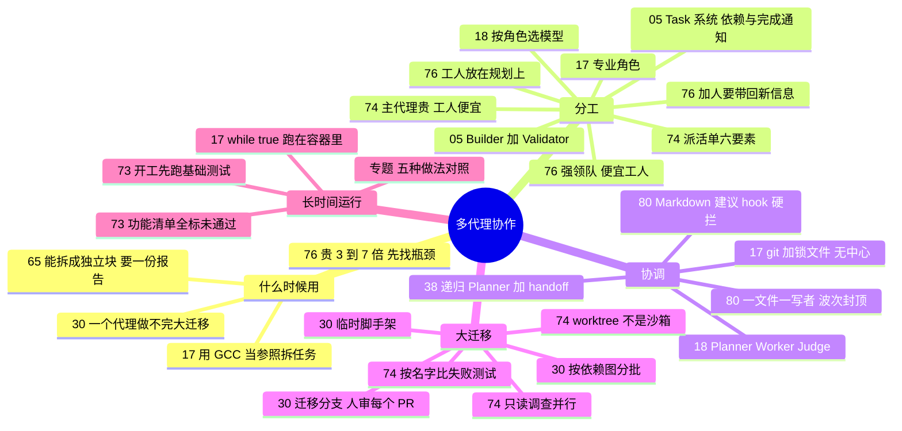

# 多代理协作与大任务拆分 · 分工、协调与长时运行

**这个阶段回答**：一个代理、一个上下文装不下的任务，怎么拆给多个代理？多个代理围绕同一个目标时怎么分工、怎么协调、怎么连续跑几小时到几周？收录 9 份资料（按发布日期从新到旧）：[[80]]、[[76]]、[[74]]、[[65]]、[[17]]、[[05]]、[[18]]、[[30]]、[[73]]，另有[长时自主任务专题](/guide/long-running)。#18 的续篇 [[38]] 讲多代理 harness 的设计原理，放在 [看原理](/guide/harness)。一个人用一个主代理、按需派子代理的做法，见上一阶段 [单代理推进与一人多线](/guide/solo)。

::: tip 怎么用这页
每个问题下面列出“哪份资料的哪一节回答了它”。指南只做串联和对照，原话和细节请点进原文。
:::

**核心问题**：① 什么时候该用多个代理？② 多个代理怎么分工？③ 多个代理怎么协调，扁平还是分层？④ 互相依赖的大迁移、大重构怎么拆？⑤ 怎么让它们连续跑几小时到几周？

## 1. 什么时候该用多个代理？

- **能拆成很多独立的块、最后要一份报告时**：这是 Grok Build Workflows 给的判断标准；它把任务写成分阶段的扇出脚本在后台跑，每个代理从干净的上下文开始，可以内建一个“怀疑者”核验阶段，跑通后存成团队共享的带参数命令（[[65§3.1]]、[[65§3.2]]、[[65§3.3]]）。这篇只是产品公告，没有效果和成本数据（[[65§4]]）。
- **一个大任务没法直接并行时，先找参照把它拆开**：C 编译器实验用 GCC 当 Oracle，把“编译 Linux 内核”这个大任务拆成很多可以并行修的小任务（[[17§3.5]]）。
- **一个代理一次做不完时**：让代理一次迁移 100 个服务，它会做 3 个就把剩下的推回给你；原因一半在代理（上下文不够、偷懒、错误累积），一半在人（说不清直觉、不知道怎么拆、没有完成标准）（[[30§3.1]]）。
- **先算账：团队比单代理强，但贵好几倍**：Cohere 的受控实验里，Sol 团队比 Sol 单代理多 5–10 个点，成本是 4–7 倍；只给单代理一个“探索 → 实现 → 验证”的结构化流程，就能补回一部分差距（[[76§3.2]]）。
- **代理多不等于结果好**：IndyDevDan 指出普通子代理缺共同任务、依赖关系和完成通知，Task 系统补的就是这三样（[[05§3.1]]）。只是上下文装不下、派几个子代理就够的情况，见 [单代理推进与一人多线](/guide/solo)（[[08§3.4]]）。

## 2. 多个代理怎么分工？

- **最小团队：一个写、一个查**：builder 只执行一个任务、不派生其他代理，自带 lint 检查；validator 从配置上就不能写文件（[[05§3.3]]）。
- **计划格式靠机制保证**：用模板元提示词生成固定格式的计划，规划代理结束时由 Stop hook 检查必需章节，缺了就退回（[[05§3.2]]）；需求和编排分开传，换一句编排提示词就能换团队结构（[[05§3.4]]）。
- **按角色配模型和权限**：Cursor 发现当时 GPT-5.2 当 Planner 比专门写代码的模型更好（[[18§3.3]]）；子代理按角色配只读或可写权限的做法见 [[08§3.5]]。
- **专业角色**：Carlini 在主线开发之外，派代理专门合并重复代码、优化性能、做架构评审（[[17§3.6]]）。
- **工人放在任务的瓶颈上**：ProgramBench 要靠运行黑盒程序摸清行为，只委派探索和规划就追平三阶段全委派，成本 $249 对 $510；规格已写好的 Commit0 上，最值得委派的反而是实现（[[76§3.3]]）。
- **领队用强模型，工人可以便宜**：Sol 领队配 Luna 规划工人，用 13.9% 的额外成本拿到全强队 47.5% 的增益；但 Terra 领队配工人仍追不上 Sol 单干（[[76§3.4]]）。加人之前先问它能不能带回新信息：规划工人越多，参考程序跑得越多；实现工人越多，每人分到的活越薄，领队检查次数却不变（[[76§3.5]]）。
- **人、主代理、工人三层**：Blocshop 的 .NET 迁移里，人定目标、范围和验收；用贵模型的主代理管依赖图、检查点、已知失败和未决风险；便宜的工人只做一个包、一个 fixture、一组 Dockerfile 这样有边界的调查（[[74§3.2]]）。
- **派活单写满六项**：问题、归属（能动哪些仓库、文件、worktree）、上下文、检查、交付物、停止条件；需要改应用行为时工人必须退回等决定（[[74§3.2]]）。交回来的 handoff 要带路径、发现、改动、验证结果和剩余不确定，被否决的方案也要记下来（[[74§3.3]]）。

## 3. 多个代理怎么协调，扁平还是分层？

- **扁平 + 锁**：C 编译器实验没有编排者，16 个代理靠共享 git 仓库和 `current_tasks/` 锁文件认领任务（[[17§3.2]]）。
- **扁平在规模大时失败**：Cursor 的第一版也是平等协作 + 锁，二十个代理只剩两三个的有效吞吐；改乐观并发后，代理又变得规避风险、只做小而安全的改动（[[18§3.1]]）。
- **分层**：第二版改成 Planner / Worker / Judge（[[18§3.2]]）。结构要适中，专门的 integrator 角色制造的瓶颈比解决的还多（[[18§3.4]]）。续篇补充了最终版：根 Planner 递归派生子 Planner，Worker 做完写交接报告（handoff）交回上级（[[38§3.4]]）。
- **互发消息不一定有用**：给代理一个 `send_message` 工具后，84% 的消息是向领队汇报，工人之间每题不到一条；强模型团队分数不变，弱模型团队掉 4–7 个点（[[76§3.6]]）。异步领队省时间，但提示词不给结构时它会自己包办，丢掉大半增益（[[76§3.2]]）。
- **验证器决定上限**：自主代理之间没有人实时盯着，测试有漏洞，代理就会去解决一个错误的问题；测试输出也要写给代理看（[[17§3.3]]、[[17§3.4]]）。
- **失败在缝合处，用 hook 挡而不是再写规则**：3,315 次子代理启动的事故几乎都过了当时的测试——并行覆盖翻译目录、清理删掉已完成 worktree、代理改门禁脚本；作者的配置里 Markdown 是建议，约 40 个编排 hook 才是硬规则（[[80§3.1]]、[[80§3.2]]）。先装：启动账本、一文件一写者、先收集再清理、检查移出可写路径、波次封顶 5、重复失败再升级模型（[[80§3.4]]）。

## 4. 互相依赖的大迁移、大重构怎么拆给多个代理？

- **迁移分支 + 背景说明 + 人审每个 PR**：OpenHands 开一条迁移分支，用 AGENTS.md 或 microagent 写明在做什么，代理的 PR 都合进这条分支，最后整体合入 main；刚开始只同时跑 3–5 个代理，目标是 90% 自动化（[[30§3.2]]）。
- **好的子任务有四个条件**：一个代理一次做完、能并行、能快速验证、依赖清晰（[[30§3.4]]）。
- **按依赖图分批，从叶子节点往上做**：每批是“一个代理能处理、一个人能看懂”的 PR 大小，验证器发现问题再派修复器（[[30§3.3]]、[[30§3.4]]）。
- **需要新旧共存时先搭脚手架**：Redux 迁 Zustand 时先让两者能同时运行，每迁完一个组件都能测（[[30§3.4]]）。
- **开工前建基线，按名字比失败测试**：只比总数会把“一个修好、一个新坏”藏起来；66 个项目的清单之外，还要找出主 solution 外的测试项目和独立的部署清单仓库（[[74§3.1]]）。
- **并行只给独立调查，写操作集中**：容器阶段三个只读评估并行，中心的 Docker 和流水线改动由主代理整合；紧耦合的改动派给多个工人只会得到互相冲突的补丁（[[74§3.2]]）。共享库先于下游，跨仓引用和共享 SDK 版本锁定限制并发。
- **worktree 不是沙箱**：它分开工作副本，不分开权限；提交、推送、部署和线上数据库都要单独批准，默认指向生产的 Kubernetes context 每次都要显式改（[[74§3.4]]）。
- **测试失败时，人决定要保护什么行为**：decimal 精度测试在 SQLite 上失败，不等于生产 SQL Server 有问题；代理复现和试改，工程师判断替身合不合适（[[74§3.5]]）。每个改动都要跟到发布后果：构建通过不代表运行时兼容，流水线绿了不代表部署的是对的镜像（[[74§3.6]]）。
- **代理学到的东西怎么共享**：共享一切会撑爆上下文；更新共享的 AGENTS.md 并经人审是较实用的做法（[[30§3.5]]）。

## 5. 让代理连续跑几小时到几周

- **让代理不停下来**：一个 `while true` 循环就够了，但要在容器里跑（[[17§3.1]]）。
- **跨很多会话接力时，把记忆放进仓库**：Anthropic 的做法是第一个会话只搭环境：200 多条全部标为未通过的 JSON 功能清单、`init.sh`、进度文件、初始提交（[[73§3.2]]）；之后每个会话先 `pwd`、读进度和 git 日志、跑一遍基础端到端测试，再只做一个功能，收尾提交 git 并更新进度（[[73§3.3]]、[[73§3.4]]）。代理只许改 `passes` 字段，且必须像用户一样用浏览器测过（[[73§3.5]]）。
- Ralph 循环、C 编译器、Cursor 数百代理、Anthropic 的功能清单接力和 Planner / Generator / Evaluator 在上下文策略、协调方式、停止条件和验收上各不相同，对照表见 **[长时自主任务专题](/guide/long-running)**。其中 Ralph 和 Planner / Generator / Evaluator 的设计原理放在 [看原理](/guide/harness)。

## 6. 来源之间的分歧

| 议题 | 观点 A | 观点 B | 怎么理解 |
|---|---|---|---|
| 扁平协作还是分层 | C 编译器：16 个代理、锁文件、无中心调度，能跑通（[[17§3.2]]） | Cursor：锁和扁平结构在数百代理时失败，改为分层（[[18§3.1]]、[[18§3.2]]） | 规模不同。十几个代理、任务边界清楚时扁平够用；几百个代理、任务需要持续拆分时需要分层。 |
| 要不要专门的协调角色 | C 编译器：给代理分专业角色有帮助（[[17§3.6]]） | Cursor：专门的 integrator 反而成了瓶颈（[[18§3.4]]） | “专业分工”可以加，“所有改动都过一个人”的关卡要慎加。 |
| 人在环里站在哪 | OpenHands：人审每个代理的中间 PR，审完再解锁下一批（[[30§3.2]]、[[30§3.3]]） | C 编译器：没有人实时盯着，靠近乎完美的测试兜底（[[17§3.3]]） | 取决于有没有可靠的自动验证。验证器不够好时，人就得审中间产物；有 Oracle 和完整测试时，才适合放手。 |
| 并行做什么 | Grok Build Workflows：把任务扇出给成百上千个代理，每个从干净上下文开始（[[65§3.1]]） | Blocshop：只有只读调查并行，写操作集中由主代理整合；紧耦合改动不拆给多个工人（[[74§3.2]]） | 前者的典型任务是审查、分诊、审计，产物是一份报告；后者是互相依赖的迁移，产物是要合进生产的改动。能拆成独立块时放开扇出，改动彼此耦合时只并行读。 |
| 一个代理接力还是多代理 | Anthropic：同一个代理跨会话接力，靠功能清单和进度文件交接；但作者也承认“单个通用代理还是多代理更好”尚无定论（[[73§3.3]]、[[73§4]]） | C 编译器、Cursor：多个代理同时跑，靠锁文件或分层协调（[[17§3.2]]、[[18§3.2]]） | 任务能串行一项项推进时，一个代理接力最简单；要在有限时间里铺开大量独立子任务时，才需要多代理和协调机制。两者交接都靠写在仓库里的文件。 |
| 钱花在哪个阶段 | Cohere：工人放在瓶颈阶段，ProgramBench 上是探索和规划，三阶段都委派只是多花钱（[[76§3.3]]） | Factory：编排者、实现者、验证者三角色固定循环，验证者先建完成标准（[[59§3.4]]） | 不矛盾：Factory 的验证者先探查参考程序，做的正是 Cohere 说的“发现要造什么”；区别是 Cohere 用对照实验量出每个阶段的性价比，Factory 的三角色系统在 gdal 上贵 14 倍、慢 13 倍（[[59§3.5]]）。 |
| 规则写在哪才挡得住 | 多数资料默认把规范写进 CLAUDE.md / AGENTS.md 给人（和模型）读 | Denys：代理读 Markdown，过不去的是 hook；事故后 60 天仍只靠一行规则等于没挡（[[80§3.1]]、[[80§3.2]]） | 不矛盾：规则文件仍要写清意图；挡副作用和改门禁，必须另有退出码拦截。与验收阶段“按效果写 hook”（[[81§3.1]]）同向。 |
| 代理之间共享多少上下文 | Builder + Validator：验证者把具体问题直接反馈给构建者（[[05§3.3]]） | OpenHands：共享全部上下文会撑爆窗口，经人审的共享 AGENTS.md 最实用（[[30§3.5]]） | 不矛盾：一写一查之间传的是具体问题；大规模并行时只沉淀经过筛选的经验。 |

## 7. 推荐阅读顺序

1. [[05]]：最小代理团队：一写一查、Task 系统和计划模板。
2. [[76]]：先算账：多代理团队值不值、工人该放在哪个阶段、领队和工人用什么模型。
3. [[80]]：团队跑起来以后缝合处怎么爆、六件先装的挡板。
4. [[30]]：互相依赖的大迁移怎么拆给并行代理。
5. [[17]] → [[18]]：从十几个代理到几百个代理，协调方式怎么变；想知道每一版为什么失败，接着读 [[38]]。
6. [[74]]：一个普通团队规模的真实迁移：主代理管依赖图、派活六要素、worktree 不是沙箱，以及几次“看起来成功”的陷阱。
7. [[65]]：很短，看“扇出 + 核验 + 存成命令”被做成产品功能的样子。
8. [[73]]：一个代理跨几十个会话接力的最小脚手架：功能清单、进度文件、开工检查。
9. [长时自主任务专题](/guide/long-running)：五种长时任务做法放在一起对照。

::: info 上一阶段 / 下一阶段
← [单代理推进与一人多线](/guide/solo) ｜ 代理说“做完了”之后，进入 [验收这一次的产出](/guide/review) →
:::
