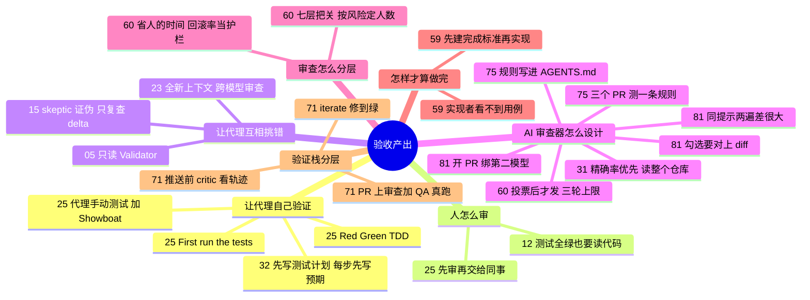

# 验收这一次的产出 · 测试、审查与完成标准

**这个阶段回答**：代理说“做完了”，怎么确认它这一次真的做完、做对了？测试、人工审查、对抗式审查、AI 审查器和独立的完成标准分别管什么？收录 10 份资料（按发布日期从新到旧）：[[60]]、[[81]]、[[15]]、[[59]]、[[75]]、[[12]]、[[71]]、[[32]]、[[25]]、[[31]]。很多相关做法散落在其他阶段，本页一并串起来。评测代理本身、给动作把关的分类器，见下一阶段 [评测代理本身与给动作把关](/guide/evals)。

::: tip 怎么用这页
每个问题下面列出“哪份资料的哪一节回答了它”。指南只做串联和对照，原话和细节请点进原文。
:::

**核心问题**：① 为什么验证是用好代理的前提？② 写代码时怎么让代理自己验证？③ 人怎么审？④ 怎么让代理互相挑错？⑤ AI 审查器该怎么设计？⑥ 大任务上代理为什么提前说“做完了”？⑦ 代码多到读不过来时，审查怎么分层？⑧ 最后由谁验收？

## 1. 为什么说验证是用好代理的前提？

- **能验证的才能交给 AI**：Factory 引用“验证不对称性”：最适合 AI 的问题有客观真相、验证快（[[26§3.1]]）。没有能自动判断 PR 是否基本可用的验证，就无法同时跑多个代理（[[26§3.4]]）。
- **验证就是“代理能不能把东西跑起来”**：Claude Code 团队的定义（[[01§3.2]]）；OpenAI 团队说并行代理需要并行环境和测试（[[10§3.2]]）。
- **验证器要近乎完美**：Carlini 说任务验证器不够好，代理就会去解决一个错误的问题（[[17§3.3]]）。
- 让代码库“好验证”属于打地基，见 [打地基](/guide/foundation)。

## 2. 写代码时，怎么让代理自己验证？

- **Red/Green TDD**：先写测试、确认失败，再实现到通过。一句 prompt 就能装进整套纪律（[[25§3.1]]）。
- **新会话先跑测试**：既让代理了解项目，也让它意识到“这里有测试，要维护”（[[25§3.2]]）。
- **测试通过 ≠ 能用**：让代理真的启动程序、像用户一样操作（[[25§3.3]]），并用 Showboat 这类工具留下可复查的记录（[[25§3.4]]）。Bijan 的实测里，代理也用无头浏览器自测（[[13§3.4]]）。
- **让代理带着证据交付**：Devin 用 Computer Use 测自己的改动，先根据源码写测试计划（[[32§3.1]]），每一步操作前写下预期以免“自我说服”（[[32§3.2]]），登录等重复步骤固化成确定性脚本放进测试技能（[[32§3.3]]），最后交回带截图的报告和分章节录屏（[[32§3.5]]）。

## 3. 人怎么审代理的产出？

- **测试全绿也可能是错的**：24 个测试全过、Clippy 无警告，ForrestKnight 读代码仍发现按字符串比较版本号、重复造轮子（[[12§3.3]]）。
- **交给同事前自己先审**：没审过的代码丢给同事，就是把真正的工作委派给别人；PR 要小、要附证据，PR 描述也要自己审（[[25§3.5]]）。
- **审意图，不只审代码**：Peter 把外部 PR 当作 “Prompt Request”，先让代理解释意图（[[11§3.5]]）。

## 4. 怎么让代理互相挑错？

- **对抗式验证“完成”**：`/goal` 声称完成后，skeptic 代理被要求证伪“目标已达成”，发现真实问题后只复查 delta（[[15§3.3]]）。
- **做与查分离**：只读的 validator（[[05§3.3]]）；扇出找 bug + 对抗式复核（[[02§3.5]]）；`/clear` 后的新会话审查 + 跨模型审查（[[23§3.3]]）；单独调教的 Evaluator（[[16§3.4]]）。

## 5. AI 审查工具本身该怎么设计？

- **推送前看轨迹 + PR 上真跑**：OpenHands 的 critic 给运行打分，低分早停或重试；PR 上 code review skill（可按仓定制）加 QA 代理实际起服务验证；`/iterate` 开 draft PR 修到绿再 ready（[[71§3.1]]–[[71§3.4]]）。
- **精确率优先**：误报多的审查器会被开发者绕开。OpenAI 用“发现真问题的收益 − 核实成本 − 误报代价”决定一条意见值不值得发，并允许用 AGENTS.md 调整松紧（[[31§3.1]]）。
- **给审查者整个仓库和执行能力**：只看 diff 会漏掉改动和依赖的交互（[[31§3.2]]）。
- **验证比生成便宜**：否定一个改动只需要有针对性地提出假设并检查，审查者用一小部分 token 预算就能抓到很多已知的严重问题（[[31§3.4]]）。
- **发之前先投票，审查要收敛**：Claude Code 团队几个代理并行找 bug、另一组投票确认，风格类意见直接丢掉；每条发现必须修掉或写理由关闭（[[60§3.3]]）。一个 PR 一夜被审 50 多轮后，他们设了三轮上限、之后只审新 diff、不重复已发的发现；事故 PR 汇成评测集每天跑（[[60§3.5]]）。
- **用 REVIEW.md 告诉审查者“这里的失败长什么样”**：限 nit、列跳过路径、要求文件和行号作证据（[[60§3.2]]）。
- **把审查者反复说的话写成仓库规则**：Codex Code Review 读 `AGENTS.md` 里的 Code Review Rules，根目录放全仓规则、子目录放服务规则；真实例子是“实验性但已被 Codex Cloud 使用的事件名不能改”（[[75§3.2]]）。每条写不变量、触发条件和安全做法，删掉不改变审查结果的规则就别写（[[75§3.4]]）。
- **规则也要测，而且不只测召回**：OpenAI 按覆盖、克制、保留（普通 bug 照抓）、可操作四个维度评测，主套件里有规则找回 98% 应有发现、基线 58.3%（[[75§3.3]]）；上手时用“该触发 / 安全反例 / 无关改动”三个 PR 验一条规则（[[75§3.5]]）。
- **用结果指标迭代**：Cursor 用“解决率”（合并时被修掉的 bug 比例）衡量 Bugbot，再做爬山式实验（[[33§3.3]]、[[33§3.4]]）。
- **同提示审查方差很大，要强制第二模型**：45 个人审 bug 回放，同一提示两遍 21/45 对 14/45；开 `gh pr create` 前 hook 检查与分支 / merge-base / head 绑定的裁决，审查用另一模型族且只看 diff，门禁失败关闭（[[81§3.2]]、[[81§3.3]]）。规则按**效果**写成 hook（清数据、占用测试机），允许列表优于拒绝列表（[[81§3.1]]）。勾选完成还要问每项对应的 diff 在哪——28 项全绿仍有 3 项没实现（[[81§3.3]]）。

## 6. 大任务上，代理为什么会提前说“做完了”？

- **自检只覆盖它想到的部分**：代理边做边验证，检查继承了那块工作的范围，没想到的功能永远测不到；gdal 单代理 1.7 万行、36% 就自己收工了（[[59§3.1]]、[[59§3.2]]）。
- **实现之前先建完成标准**：清单 + 每部分的确立程序 + 当前证据；可以加强，不能塌缩到已做的东西上（[[59§3.3]]）。
- **出题和答题分开，中间有墙**：验证者建 instrument 并测候选，实现者不看用例和原始输出，只收到按根因聚类的功能级指令（[[59§3.4]]）。
- **效果和代价**：三个模型中位数都提升，gdal 到 90%，但花了 14 倍额度、每格只跑一次（[[59§3.5]]）。
- **同一思路的小规模版本**：动手前签冲刺契约（[[16§3.3]]）、只读 Validator（[[05§3.3]]）、`/goal` 写可验证的完成标准（[[42§3.3]]）。
- 把评测接进 CI、给代理配置做回归，见 [接进 PR 与 CI](/guide/ci)（[[57]]）。

## 7. 代码多到读不过来时，审查怎么分层？

- **先换指标**：要省的是人的时间（审查时间 + 修坏代码的时间），回滚率和事故率是护栏；“人读过没有”只是不精确的替代指标（[[60§3.1]]）。
- **七层把关**：提交前自证和新上下文子代理审 diff → 每个 PR 的 AI 审查 → 可阻断的安全审查 → lint / 类型 / 测试 / 构建 → 按风险的人工批准 → merge queue、flag、分阶段发布 → 快速回滚（[[60§3.2]]–[[60§3.5]]）。
- **人工批准按改动定档**：低风险 0 人、中风险 1 人、高风险 2 人；分类器定档，敏感路径和 CI workflow 永远要人；代理的批准不算人的，批准绑定具体 commit（[[60§3.4]]）。
- **人留给机器做不好的决定**：要不要做、高风险代码、会被模仿的架构、读证据、为结果负责；想了解代码就让 Claude 写那一块的讲解（[[60§3.6]]）。
- 同一团队的源代码管理怎么跟着重做，见 [[49]]；分类器给单次动作把关，见 [评测代理本身与给动作把关](/guide/evals)。

## 8. 最后由谁验收？

| 做法 | 来源 |
|---|---|
| 单独调教的 Evaluator，用 Playwright 实际操作应用 | [[16§3.2]]、[[16§3.4]] |
| 全新上下文 + 跨模型（Codex）审查 | [[23§3.3]] |
| 只读的 validator / skeptic 证伪 | [[05§3.3]]、[[15§3.3]] |
| 人先确认能用，再交给同事审 | [[25§3.5]] |
| 代理用 Computer Use 实测，交回报告和录屏 | [[32§3.5]] |
| 仓库级 AI 审查器，只发高把握的问题 | [[31§3.1]]、[[31§3.2]] |
| 确定性评分优先 | [[19§3.2]]、[[47§3.5]] |
| 实现前由独立验证者建标准，实现者看不到用例 | [[59§3.4]] |
| 按改动风险决定需要几个人批准，代理批准不算 | [[60§3.4]] |
| 写代码的会话不能当唯一审查者；开 PR 绑第二模型裁决 | [[81§3.3]] |

## 9. 来源之间的分歧

| 议题 | 观点 A | 观点 B | 怎么理解 |
|---|---|---|---|
| 人还要不要读代码 | Peter：多数代码只是数据形状转换，看输出流、对照心智模型即可（[[11§3.4]]） | ForrestKnight：测试全绿也要读（[[12§3.3]]）；Simon Willison：没审过的代码别交给同事（[[25§3.5]]）；Cole：代理审完人还要审（[[23§4]]） | 取决于出错代价和验证是否可靠，也取决于是个人项目还是团队协作。交给别人之前，至少要有证据证明它能用。 |
| AI 审查该少报还是多报 | OpenAI：精确率优先，适度牺牲召回率换取信任（[[31§3.1]]） | Cursor Bugbot：改成代理式架构后模型太谨慎，改用激进提示词鼓励多报（[[33§3.5]]） | 不完全矛盾：Bugbot 的第一版同样靠投票和验证模型压低误报（[[33§3.1]]），激进提示词是针对代理式架构“太保守”的纠偏。两者最终都以开发者是否真的去改（采纳率 / 解决率）来校准（[[31§4]]、[[33§3.3]]）。 |
| 验证者该把失败细节告诉实现者吗 | Builder + Validator、Generator / Evaluator：验证者把具体问题直接反馈给构建者（[[05§3.3]]、[[16§3.4]]） | Factory：实现者不写、不跑、不看用例和原始输出，只收到功能级指令，因为样本一旦可见就会变成目标（[[59§3.4]]） | 取决于验收用例是不是完整规格。用例只是巨大行为空间的一小块抽样时，藏起来更能防“应试”；用例本身就是完整契约时，直接给也无妨。 |
| AI 审查该跑几轮 | 默认多跑几轮，因为每轮都能多抓到一点（Claude Code 团队过去的习惯，[[60§3.5]]） | 三轮上限、之后只审 diff：约 59% 被反复标出的内容是第一轮就在的旧代码，代理作者会把每个 nit 都改一遍（[[60§3.5]]） | 高风险改动值得多轮；普通 PR 要同时看召回率和“几轮才通过”。作者和审查者都是代理时，没有上限的循环会自己烧钱。 |
| 审查标准写在哪 | Codex：写进按目录生效的 `AGENTS.md` 规则小节，和写代码的指引放一起（[[75§3.2]]） | Claude Code 团队：单独的 `REVIEW.md`（[[60§3.2]]）；OpenHands：仓库里的 `custom-codereview-guide.md` skill（[[71§3.2]]） | 文件名不同，做法一致：把审查标准从人的脑子里搬进仓库，并让它跟着代码一起被审、被改。区别在作用域：嵌套 `AGENTS.md` 天然按目录生效，单独文件要自己写清跳过哪些路径。 |
| 提示词够不够挡住副作用 | 写进 CLAUDE.md / REVIEW.md / AGENTS.md，靠模型遵守（多数资料的默认前提） | Adit：点名命令挡不住 Gradle 先卸载之类的副作用；会回来的规则要迁进 hook，按效果拦（[[81§3.1]]） | 文件里的规则仍要写；真正反复破功的路径，用退出码 2 的 hook 或允许列表。与多代理缝合处事故（[[80§3.2]]）同向。 |
| 一次干净的审查能说明什么 | OpenAI：审查者是辅助工具，不能把干净的审查当成安全保证（[[31§4]]） | Cognition：代码审查干净往往还不够，工程师想看到端到端测试过（[[32§2]]） | 两者一致：审查只是一层防御，还需要测试和真实运行的证据。 |

## 10. 推荐阅读顺序

1. [[25]]：最容易马上用起来的几条 prompt 模式。
2. [[12]]：学会审查 AI 产出。
3. [[15]]：对抗式验证的完整演示。
4. [[32]]：让代理实际操作应用并交回证据。
5. [[31]]：理解 AI 审查器为什么要“宁缺毋滥”。
6. [[59]]：大任务上代理为什么提前收工，怎样用独立的完成标准把它推到底。
7. [[60]]：代码量涨十倍以后，一个团队怎么把审查拆成七层、按风险分配人工。
8. [[71]]：推送前看轨迹、PR 上审查加真跑的两层验证栈。
9. [[75]]：把审查者反复说的话写成 `AGENTS.md` 规则，并用三个 PR 测规则有没有噪声。
10. [[81]]：CLAUDE.md 挡不住副作用时怎么迁进 hook；审查回放跑两遍看方差；开 PR 强制第二模型。

::: info 上一阶段 / 下一阶段
← [多代理协作与大任务拆分](/guide/multi) ｜ 验收了一次产出，再系统地评测代理本身：[评测代理本身与给动作把关](/guide/evals) →
:::
