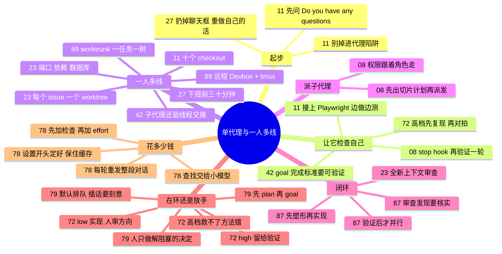

# 单代理推进与一人多线 · 一个人怎么驾驭代理

**这个阶段回答**：计划定好后，一个人怎么让代理把活干完？刚上手怎么建立判断，怎么让代理自己检查自己，一个人怎么同时推进几件事，什么时候该派子代理，人不在电脑前怎么继续推进，钱花在哪？这里的主角始终是“你 + 一个主代理”：任务彼此独立，协调靠人。收录 10 份资料（按发布日期从新到旧）：[[87]]、[[42]]、[[72]]、[[78]]、[[89]]、[[79]]、[[08]]、[[23]]、[[11]]、[[27]]。多个代理要围绕同一个目标分工、协调、长时间运行时，进入下一阶段 [多代理协作与大任务拆分](/guide/multi)。

::: tip 怎么用这页
每个问题下面列出“哪份资料的哪一节回答了它”。指南只做串联和对照，原话和细节请点进原文。
:::

**核心问题**：① 刚开始用代理，怎么才不会“越用越觉得没用”？② 怎么让一个代理边做边检查自己？③ 一个人怎么同时推进多件事？④ 什么时候该派子代理，派出去的分身怎么管？⑤ 什么时候自己在环里盯着，什么时候放手让它多做？⑥ 一个任务的钱花在哪，怎么少花？⑦ 塑形—构建—审查—交付怎么串成闭环？

## 1. 刚开始用代理，怎么才不会“越用越觉得没用”？

- **先换形态，再谈效率**：Mitchell Hashimoto 的第一步是扔掉聊天框，改用能读文件、跑命令的代理（[[27§3.1]]）；第二步是把自己刚手动做完的活让代理重做一遍，建立“它稳赢什么、必败什么”的直觉（[[27§3.2]]）。
- **少折腾工具链**：Peter Steinberger 把过度复杂的配置叫作 “agentic trap”，自己刻意保持简单（[[11§3.2]]）。
- **每个任务先让它提问**：模型默认会自己做假设，新会话对代码库一无所知，Peter 每次都问一句 “Do you have any questions?”（[[11§3.3]]）。
- **按场景选控制方式**：Codex 应用里，没有 API 的桌面软件用 Computer Use，需要登录态用 Chrome 扩展，本地网页测试用应用内浏览器（[[42§3.2]]）。
- **每犯一个错，就改一次环境**：简单的写进 AGENTS.md，复杂的写成脚本工具（[[27§3.5]]）；规则文件怎么写见 [打地基](/guide/foundation)。

## 2. 怎么让一个代理边做边检查自己？

- **能检查自己，代理才真正能用**：Peter 的“开窍”时刻是 spec → build → 再给代理接上验证工具（Playwright），让它边做边测（[[11§3.1]]）。
- **完成标准要可验证**：`/goal` 的完成标准写不清，它会“技术上做到了，但不是你要的”；把目标写进文件，在里程碑处做目标审计，卡住时标记 blocked 并说清楚人要做什么（[[42§3.3]]）。
- **确定性的检查交给 hooks**：密钥扫描、工具白名单、收尾校验不要只写在提示词里（[[42§3.3]]）；长任务可以用 stop hook 强制再验证一轮，验收要去目标系统里看（[[08§3.2]]、[[08§3.6]]）。
- **让它多测边界，就给它更高的档位**：同一道题，低档一遍写完、只测一个例子；高档会先复现 bug、和暴力解法对拍、确认新测试在半成品修复上会失败（[[72§3.4]]）。
- **不想一直点“允许”**：别开全权限来躲审批，改让另一个代理先判（guardian approvals，[[08§3.6]]）；权限放开之前先想清楚谁能跟代理说话（[[11§3.6]]）。
- 代理说“做完了”之后怎么正式验收，见 [验收这一次的产出](/guide/review)。

## 3. 一个人怎么同时推进多件事？

- **多份工作目录并行**：Peter 不用 worktree，直接开 checkout 1 到 10（[[11§3.2]]）；Cole Medin 把每个 GitHub issue 当作规格，每个 issue 一个 worktree，各自规划、实现、开 PR（[[23§3.1]]、[[23§3.2]]）。
- **远程常开 + tmux + worktrunk**：Charles 把执行放远程 Devbox，笔记本只做控制台；一任务一 worktree，SSH 断线用 `tmux new -A` 续；离开前 `/goal` 写清验收，比 24/7 空转重要（[[89§3.2]]、[[89§3.3]]）。
- **并行时的真实难题**：端口冲突、依赖重复安装、数据库互相污染，Cole 现场给了三种解法（[[23§3.5]]）。
- **长任务怎么拆线程**：只关心结果用子代理，想全程参与就开多个线程互相交接；侧线程是临时的，结论要回传主线程（[[42§3.3]]）。
- **利用人不在的时间**：Mitchell 下班前 30 分钟启动代理做调研和分诊，第二天把“稳赢”的任务交给后台代理，并关掉代理通知（[[27§3.3]]、[[27§3.4]]）。“总有一个代理在跑”只是目标，他自己也只做到工作日的一小部分（[[27§3.6]]）。
- **让它定期自己开工**：线程内心跳适合“等它好了再做下一步”，新线程适合每周一次的独立任务（[[42§3.4]]）；接进团队的 PR 和 CI 见 [接进 PR 与 CI](/guide/ci)。

## 4. 什么时候该派子代理，派出去的分身怎么管？

- **单个上下文装不下时**：一个代理审 45 个文件，上下文会被塞满；先让主代理出切片计划，切成 20 个审查切片交给子代理，每个都在干净的上下文里工作（[[08§3.4]]）。切的可以是文件，也可以是假设或方案。
- **权限跟着角色走**：审查、找漏洞的子代理只读，写文档、写 bug report 的才给写权限；定期拿“职责”对照“权限”（[[08§3.5]]）。
- **审查放在全新上下文里**：先 `/clear`，再按改动类型并行派审查子代理，审查者不看写代码者的聊天记录；再请另一家模型审一遍（[[23§3.3]]）。人看不过来时，让另一个代理做第一遍审查（[[08§3.3]]）。
- **修 bug 也修“产生 bug 的系统”**：每个 bug 都问一句是哪条规则、技能或流程放它进来的，然后改那一层（[[23§3.4]]）。
- 子代理在这里是主代理的工具：主代理派活、收结果，人只和主代理打交道。代理之间要分工、认领任务、互相交接时，就到了 [多代理协作与大任务拆分](/guide/multi)。

## 5. 什么时候自己在环里盯着，什么时候放手？

- **effort 档位其实是“在环还是放手”的旋钮**：Thariq Shihipar 的定义是，effort 调的是代理做多少验证、边界测试，用多少自己的判断（[[72§3.1]]）。
- **常规功能的四步循环**：给 spec 让它采访你补细节 → low 实现 → 人审大方向、low 迭代 → high 验证和测试（[[72§3.2]]）。规格越清楚，四个档位的结果越接近。
- **高档帮的是“漏边界”，不是“方法错”**：Terminal-Bench 的失败分类里，提高 effort 主要减少漏掉边界情况的失败，“选错了理解方式”的次数反而变多（[[72§3.3]]）。方向还得靠人先审。
- **四档经验法则**：low 头脑风暴和简单改，medium 常规新功能，high 棕地修 bug，max 无人在环的难题（[[72§3.5]]）。没人在旁边、边界又多的任务，直接用高档（[[72§3.4]]）。
- **人在环里，其实是“做决定”**：Thomas Ricouard 列了六个会卡住代理的决定：用哪个工作区、当前分支还是新 worktree、下一句话排队还是插话、这条命令能不能批、改动同不同意、该变成 goal 还是旁支问题（[[79§3.1]]）。这些决定在手机上也能做：开工前选好环境（[[79§3.2]]）；跟进消息默认排队，只在方向错时插话，插话只用来收窄范围或纠正假设（[[79§3.3]]）；旁支问题开 side chat，风险大的先 plan 再 goal（[[79§3.4]]）；权限只批最窄的一档（[[79§3.5]]）；目标没变就压缩、方向变了就 fork（[[79§3.6]]）。
- 长任务里“放手”之后怎么不跑偏，见 [多代理协作与大任务拆分](/guide/multi) 和 [[73]]。

## 6. 一个任务的钱花在哪，怎么少花？

- **按任务算，不按 token 单价算**：每一轮都重发整段对话，上下文从没超过 120K 的 40 轮任务也会处理 2.8M 输入；缓存命中率从 0% 到 90%，同一批输入从 $11.20 降到 $1.62（[[78§3.1]]）。
- **调档顺序**：先给模型一个能检查自己的手段（测试、构建、调接口的脚本），再把 effort 从 medium 升到 high，xhigh 在同一问题上失败两次再换大模型（[[78§3.3]]、[[78§3.4]]）。档位本身怎么选见本页第 5 节和 [[72]]。
- **子代理按角色选模型**：查找、读日志、跑测试交给 Haiku 或 Sonnet（`model: haiku` 或 `CLAUDE_CODE_SUBAGENT_MODEL`），写代码和做判断留在主模型；代理团队约是普通会话的 7 倍 token（[[78§3.4]]）。
- **保住缓存**：停顿超过缓存寿命、换模型、中途连 MCP、在云厂商上改 effort、首次开 fast mode、压缩对话都会让缓存重写；设置在开头定好，休息前 `/compact`，换任务 `/clear`（[[78§3.5]]）。
- **量自己的数**：任务结束时在 `/usage` 看缓存占比、输出对输入、总输入对对话大小（[[78§3.6]]）。

## 7. 来源之间的分歧

| 议题 | 观点 A | 观点 B | 怎么理解 |
|---|---|---|---|
| 并行多少 | Peter：10 个 checkout 同时跑（[[11§3.2]]） | Mitchell：只跑一个后台代理，关掉通知，自己决定何时查看（[[27§3.4]]、[[27§3.6]]） | 并行数量受人的审查能力限制，不受代理数量限制。Robert Brennan 给新手的建议是 3–5 个（[[30§3.2]]）。 |
| 并行隔离用什么 | Cole：git worktree + 脚本处理端口、依赖、数据库（[[23§3.5]]） | Peter：不用 worktree，直接多份 checkout（[[11§3.2]]）；Charles：worktrunk 命名 + 远程 Devbox/tmux 保活（[[89§3.2]]） | 都是“每个代理一个独立工作目录”。真正的难点在端口、依赖、数据库这些共享资源；还要不要远程保活，看你是否常合盖/通勤。 |
| 人还要不要读代码 | Peter：不逐行读，看输出流、对照心智模型（[[11§3.4]]） | Cole：代理审完、跨模型再审，人还要审（[[23§3.3]]）；更多观点见 [验收这一次的产出](/guide/review) | 取决于出错代价、验证是否可靠，以及是个人项目还是团队协作。 |
| effort 默认开多高 | Claude Code workshop：effort 推荐 xhigh，也可以设 max（[[03§3.5]]） | Thariq Shihipar：常规功能用 medium，实现阶段用 low，验证阶段再升到 high（[[72§3.2]]、[[72§3.5]]） | 看规格清不清楚：#03 的任务先有完整 spec 再整段交给代理，正是“规格清楚、档位差别小”的情况；规格还在变时，低档更便于来回迭代。 |
| 省钱先动哪个旋钮 | Thariq Shihipar：按“想多在环”选 effort，实现用 low、验证用 high（[[72§3.2]]） | Addy Osmani：先加检查手段，再提 effort，最后才换模型；高档省下一次重试就回本（[[78§3.3]]） | 不矛盾：一个从“代理替你做多少决定”看档位，一个从账单看；两篇都说日常从 medium 或更低开始，验证要紧时才升档。 |
| 人要多频繁地看代理 | Mitchell：关掉通知，自己决定何时查看（[[27§3.4]]） | Thomas Ricouard：完成通知一键回到审查，手机上随时批权限、插话（[[79§3.5]]、[[79§3.7]]） | 都是“别一直盯着”：一个靠关掉打扰，一个靠只在需要决定时被叫回来。看你的任务是否经常卡在审批上。 |
| 子代理还是多线程 | Codex 工作坊：只要结果用子代理，想全程参与开多个线程（[[42§3.3]]） | Codex Masterclass：子代理的前提是“能各干各的”，先出切片计划再派发（[[08§3.4]]） | 不矛盾：一个按“谁需要看见过程”选，一个按“任务能不能切开”选，两条可以一起用。 |

## 8. 推荐阅读顺序

1. [[27]]：心态与节奏，最适合刚起步。
2. [[11]]：一个人维护大型开源项目的真实做法。
3. [[23]]：完整的并行开发演示，端口、依赖、数据库的解法可以照抄。
4. [[89]]：远程 Devbox + tmux + worktrunk，笔记本变控制台。
4. [[08]]：子代理怎么切片、怎么按角色配权限。
5. [[42]]：Codex 应用里 `/goal`、子代理、线程交接和自动化的实际用法。
6. [[72]]：effort 档位怎么选：低档在环迭代，高档留给验证。
7. [[78]]：一个任务的钱花在哪：轮数、缓存、输出和模型。
8. [[79]]：人不在电脑前时，怎么继续驾驭代理。

::: info 上一阶段 / 下一阶段
← [做规划](/guide/planning) ｜ 一个代理不够、要让多个代理分工时，进入 [多代理协作与大任务拆分](/guide/multi) →
:::
