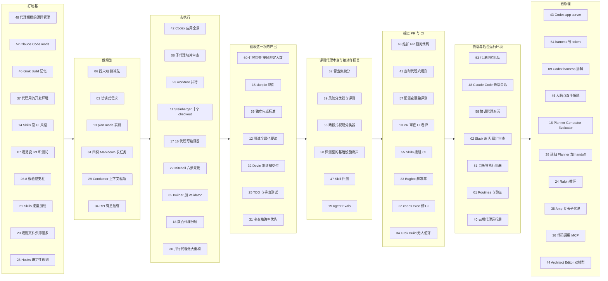

## 这是什么

**分类原则：按一个 AI 代理开发任务从开始到上线的顺序分组。** 八个阶段依次是：打地基（上下文与规范）→ 做规划 → 去执行 → 验收这一次的产出 → 评测代理本身与给动作把关 → 接进 PR 与 CI → 云端与后台运行环境，最后是看原理（Harness 与内部机制）。每份资料只放在它主要贡献所在的那个阶段。

一个持续更新的中文知识库，主题是**怎样用编码代理（coding agent）把软件做好**。内容分三层：

| 层次 | 是什么 | 从哪进 |
|---|---|---|
| 单篇资料 | 每份视频 / 文章一篇拆解，开头一份收获清单，再分 5 节：基本信息、这篇在回答什么、怎么做、结果与局限、结论 | 左侧边栏，或[全部资料](/all) |
| 阶段指南 | 每个阶段一页，把多份资料串起来回答几个核心问题，并标出来源之间的分歧 | 左侧边栏每组第一项 |
| 工具页面 | [学习路径](/paths)、[模式库](/patterns)（29 个做法）、[术语表](/glossary)、[更新日志](/changelog)；另有[总结](/00-summary) | 顶部导航 |

整理开始于 2026-10-08，最近一次更新：2026-10-19（见[更新日志](/changelog)）。工具和资料类型标在每篇文章的标题下方。

::: tip 阅读小功能
- **术语一点就懂**：文章里带品牌色点状下划线的词，鼠标悬停能看到一句话解释，点击跳到[术语表](/glossary)。
- **英文原话悬停看翻译**：原话、prompt 和配置保留英文原样，带灰色虚线下划线和“译”角标；悬停、键盘聚焦或手机点按会弹出中文翻译。
- **原始来源一键直达**：视频资料在“基本信息”最上方内嵌 YouTube 播放器；文章、官方文档和指南则放一张来源卡片（标题、作者、日期、链接）。
- **小节级引用**：阶段指南和模式库里的 `#16 §3.5` 这类链接，会直接跳到原文对应小节。
:::

## 🆕 最近收录（2026-10-19，4 份）

| # | 资料 | 阶段 | 类型 / 工具 | 综合评分 |
|---|---|---|---|---|
| 60 | [代码审查的七层把关](/60-claude-code-team-code-review) | [验收这一次的产出 · 测试、审查与完成标准](/guide/review) | 文章 Claude Code |  **4.0** |
| 61 | [Codex 跑 25 小时的四份 Markdown](/61-codex-long-horizon-tasks) | [做规划 · 需求澄清与任务拆解](/guide/planning) | 文章 Codex |  **3.5** |
| 62 | [评测设计与爬分不自欺](/62-claude-eval-design-hillclimbing) | [评测代理本身与给动作把关 · 评测、分类器与分数噪声](/guide/evals) | 文章 Claude Code |  **4.0** |
| 63 | [让代理批量开维护 PR](/63-openai-gpt-6-software-maintenance) | [接进 PR 与 CI · 触发、审查与流水线](/guide/ci) | 文章 Codex |  **3.5** |

每篇的实用性、深度评分见文章标题下方，[全部资料页](/all#scores)可以按评分排序。

## 知识库全景图

按“阶段 → 资料”展示全部 63 份资料，从左到右就是一个任务从开始到上线的顺序。每个阶段指南里还有更细的“问题 → 资料”小图。

- **[打地基 · 上下文与规范](/guide/foundation)**：让代理每次开工都拿到对的上下文：规则文件、Skills、团队规范，以及能被自动验证的代码库。
- **[做规划 · 需求澄清与任务拆解](/guide/planning)**：动手前把需求问清楚、把任务拆好：让代理采访你、找出未知、研究→计划→实施、plan mode。
- **[去执行 · 从单代理到多代理](/guide/execution)**：让代理把活干完：真实项目里的单代理用法，到子代理、并行 worktree、代理团队和长时自主任务。
- **[验收这一次的产出 · 测试、审查与完成标准](/guide/review)**：确认代理这一次真的做完、做对：测试驱动、代理手动测试、人工与对抗式审查、AI 审查器和独立的完成标准。
- **[评测代理本身与给动作把关 · 评测、分类器与分数噪声](/guide/evals)**：不只看一次产出，而是系统地评测代理和它的配置：评测零件与 pass@k、给 Skill 写评测、评测分数里的噪声，以及给代理动作把关的权限分类器。
- **[接进 PR 与 CI · 触发、审查与流水线](/guide/ci)**：让代理脱离聊天框、接进团队流水线：定时与事件触发、无人值守的规则、PR 审查机器人和 CI 自动修复。
- **[云端与后台运行环境 · 代理在哪里跑](/guide/cloud)**：让代理离开你的笔记本：云端会话、托管 VM、自托管执行机器和沙箱机队，以及背后的持久化与安全布局。
- **[看原理 · Harness 与内部机制](/guide/harness)**：理解代理外壳怎么工作：上下文、权限、循环和“做与查分离”背后的设计。

## 不知道从哪开始？

- **完全新手**：走[🌱 新手路径](/paths#beginner)，第一篇读 [#27 Mitchell Hashimoto 的六步路线](/27-mitchellh-ai-adoption-journey)。
- **想马上抄作业**：去[🧩 模式库](/patterns)，每个做法都链接到原文小节，配置和提示词原文就在文章里。
- **想看全貌**：读[总结与最佳实践](/00-summary)，或打开[📚 全部资料](/all)按阶段浏览。

::: info 资料来源与可信度
所有链接均已核实存在。视频以字幕 / 官方文字稿为主要依据，截图全部来自视频画面；文章和文档以原文全文为依据，抓取日期写在每篇“基本信息”表的“分析依据”一行。例外和局限都在对应文章中注明，覆盖情况与缺口见[全部资料页末尾](/all#coverage)。
:::
